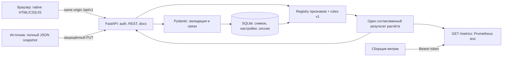

Актуализация 2026-10-25: интерфейс использует согласованные React/Vite-компоненты
поверх HTML и существующих ES-контроллеров. Сервер — прежний FastAPI/SQLite.
Сборка: `npm --prefix frontend ci`, затем `npm --prefix frontend run build:product`;
готовые локальные JS/CSS/WOFF2 находятся в `web/assets/interface/` и копируются
существующим Dockerfile. Node для исполнения сервера не требуется. Исходники,
версии и снимки компонентов сохранены в `frontend/`. Демо-аккаунты имеют отдельную
временную SQLite на браузер; mutable `app.state` не переключается глобально,
middleware передаёт запросу отдельное application view. Основные сессии, метрики,
OIDC и данные оператора используют первоначальное состояние приложения.
Ниже сохранён исходный архитектурный план.

# Архитектура

Статус на 2026-10-23: **выбранный план**, приложение ещё не реализовано. Перед выбором прочитаны [ТЗ](challenge.md), [правила](rules.md), [критерии](evaluation.md) и предоставленный JSON/SQL. Условия использования заготовок, OSS и AI требуют уточнения по [вопросам](open-questions.md); этот документ не выдаёт отсутствующее разрешение.

## Основной путь

Маркетолог входит → видит клиентов и стоимость продлений под риском → сортирует/фильтрует → открывает объяснение клиента → меняет коэффициент → видит пересчитанные список, карточку, сводку и метрики → после перезапуска настройки сохраняются. Загрузка нового снимка проходит тот же расчётный путь. Этот путь важнее дополнительных экранов.



Браузер опрашивает текущую версию раз в две секунды. Событийная шина, Redis, Celery, Kafka, отдельный ML-сервис и WebSocket в MVP не нужны.

## Стек и что переиспользуем

| Часть | Решение | Зачем / границы |
|---|---|---|
| Runtime | Python 3.13, FastAPI, Uvicorn | Готовые маршруты, валидация, lifecycle, OpenAPI, ASGI. Точные версии и hashes зафиксировать после установки и проверки совместимости |
| DTO | Pydantic | Исходные массивы, enum, денежные типы и ошибки валидации. Не переносить случайные ограничения fixture |
| Хранилище | `sqlite3` из stdlib, один app process | Атомарный небольшой снимок, настройки и сессии; Docker volume. Для 10/30/100 PostgreSQL-сервис не даёт нужной пользы |
| Пароли | `pwdlib[argon2]` | Проверенный password hashing, не собственная криптография |
| Сессии | Случайный непрозрачный токен, серверная запись в SQLite | Состояние logout и expiry; cookie HttpOnly, SameSite, Secure на HTTPS; CSRF для изменений |
| Метрики | Официальный `prometheus-client` | Корректный text exposition, Gauges; один `/metrics` без redirect |
| Frontend | Native HTML/CSS/ES modules, Fetch API | Существующие tokens/foundation, реальные формы и таблица. React/Vite не обязательны ради четырёх экранов |
| Swagger | Swagger UI, необходимые файлы локально | FastAPI обычно использует CDN; поставка должна открывать docs и без Интернета |
| Проверки | pytest + HTTPX TestClient, browser tool | Тесты модели/контрактов и настоящий браузерный путь; dev-зависимости отдельно |
| P1 график | Chart.js при подтверждённой необходимости | Один chart, подписи и таблица fallback. Не библиотека для всей страницы |
| P1 OIDC | Authlib, один реально доступный IdP | После P0; разрешённый provider/credentials и рабочий callback, не декоративная кнопка |

Актуальные первоисточники, лицензии, альтернативы и состав reuse — [исследование](reuse-research.md), [машинный manifest](reuse-manifest.json). Его проверка не означает, что пакеты установлены. PP Neue Machina — proprietary: текущие локальные права не доказывают право публично распространять файл.

SQLite — **новое решение для продукта**, не попытка запустить исходную PostgreSQL-миграцию на SQLite. Поставленный `data.json` является переносимым входом. SQL и генератор сохраняются как исходные материалы. Если обязательным окажется PostgreSQL, адаптер хранилища заменяется до реализации persistence; API и pure model остаются прежними.

## Границы модулей

Предлагаемая структура, пока отсутствующая в коде:

```text
app/
  main.py                 # app, lifecycle, static/UI routes
  config.py               # environment, nonsecret defaults
  contracts.py            # input/output DTO and enums
  auth.py                 # credentials, session, csrf, metrics token
  api/                    # auth, customers, analytics, model, source
  domain/
    context.py            # as_of, basket allocation, shared context
    features/             # registry and separate feature functions
    scoring.py            # pure rules-v1, reasons, unknown
    money.py              # Decimal/integer cents, aggregation
  storage.py              # SQLite repository and schema migrations
  evaluation.py           # coherent immutable evaluation by revision
  metrics.py              # collector using the same evaluation
web/
  login.html
  customers.html
  customer.html
  settings.html
  assets/                 # thin product JS/CSS, no second token theme
tests/
  unit/                   # model, rounding, auth helpers
  integration/            # REST, snapshots, settings restart, metrics
  browser/                # source and executable journey when added
```

Точные имена файлов может упростить реализующий агент. Важны границы: HTTP не содержит формул, признаки не делают запросов к БД, UI не пересчитывает риск по собственной формуле, метрики не живут отдельной моделью.

## Persistence и атомарность

Для MVP достаточно таблиц `source_snapshots`, `settings`, `sessions`, `schema_migrations`. `source_snapshots` хранит канонический JSON, checksum, номер ревизии и `received_at`; активный снимок — один. Для маленького набора читать массивы и строить индексы ID в памяти проще, чем поддерживать вторую предметную SQL-схему. Историю бизнес-событий этим хранением не считать.

Таблица settings содержит версионированный документ с весами, порогами, H, `model_version`, `updated_at`. Конфигурация по умолчанию создаётся только при отсутствии записи. При рестарте нельзя перезаписывать пользовательские настройки дефолтами или повторно импортировать первоначальный fixture поверх снимка.

Алгоритм загрузки снимка:

1. Ограничить размер запроса разумным документированным пределом (предлагается 10 MiB, свой эксплуатационный выбор).
2. Провалидировать типы, допустимые enum, уникальные ID, связи и даты **всего** документа. Не отвергать произвольные названия услуг или amount >1000 только из-за fixture.
3. Под общим mutex координатора прочитать согласованные данные/настройки, построить кандидат и вычислить его до записи. При ошибке расчёта сохранить прежний активный снимок.
4. В одной SQLite-транзакции записать снимок и новую ревизию, затем опубликовать целиком immutable Evaluation, всё ещё удерживая mutex. Только после commit и публикации вернуть подтверждённую revision.

Совпадающий канонический checksum не создаёт повторной замены и не порождает фиктивных событий. При изменении настроек применять optimistic concurrency (`If-Match` с ревизией), отдавать 409 при конфликте и сохранять введённые поля на фронтенде.

SQLite: один процесс Uvicorn/один writer, короткие транзакции, busy timeout; подключение на операцию/поток, без небезопасного общего connection. Допустим WAL после проверки в Docker volume; backup должен учитывать WAL через SQLite backup API. Не запускать несколько worker с непроверенным in-memory cache и метриками. Для большего потока, чем способен обработать процесс, сначала измерить нагрузку, затем переходить к PostgreSQL/другой архитектуре.

Mutex охватывает **все** пути изменения/публикации: PUT snapshot, PATCH settings и refresh по времени. Пары входных ревизий читаются из одной SQLite read-транзакции. На маленьком наборе вычисление внутри coordinator lock допустимо; чтение ожидает завершения и берёт цельный результат. Сам по себе один SQLite writer не предотвращает публикацию старого расчёта после нового. Если вычисление когда-либо выносится за lock, понадобится compare-and-swap проверки обеих ревизий перед публикацией. Обязателен тест одновременных PUT/PATCH с задержанным старым расчётом.

## Живое обновление и время

`Evaluation` содержит `analysis_revision`, `data_revision`, `settings_revision`, `model_version`, `evaluated_at`, все service/customer результаты и агрегаты. Одно вычисление использует неизменяемые входы и один `as_of`. `analysis_revision` меняется при источнике, настройках или пересчёте времени.

Изменения данных/настроек вычисляются, сохраняются и публикуются согласованно по алгоритму выше; дополнительно кэш имеет TTL не больше 30 секунд, чтобы приближение даты само изменяло риск. Клиентский polling — 2 секунды при видимой вкладке, немедленная проверка при возврате фокуса; без наслаивания запросов, с AbortController и backoff до 30 секунд при сбое.

Список, сводка и карточка получают версии. Frontend не склеивает список одной revision со сводкой другой: при несовпадении повторяет чтение, затем сохраняет предыдущий целостный результат до следующего опроса. На таком небольшом наборе хранить последний immutable Evaluation и быстро обслуживать все GET достаточно. Метрики берутся из того же сервиса, а не из клиентского состояния.

Цель приёмки команды: данные/коэффициенты видны во второй открытой вкладке без reload не позднее 5 секунд на локальном наборе. Это наша проверочная цель, SLA организатором не задан. В тестах использовать внедряемые часы; production — UTC now. Замороженный демонстрационный `as_of`, если понадобится, явно обозначать в панели; не выдавать фиксированное время за live.

## Доступ и ошибки

- Публичны только вход, необходимые локальные ассеты и технический `/healthz` без клиентских данных. Художественная главная может вести ко входу и не раскрывает аналитику.
- Panel, клиентские API, настройки, импорт, Swagger и OpenAPI защищены. GET без сессии — 401; UI без сессии переводит на вход.
- Cookie-сессия требует CSRF-header на PATCH/PUT/logout; проверяется same-origin. Никаких клиентских данных/секретов в localStorage, URL или логах.
- `/metrics` доступен сборщику по отдельному bearer token; этот token не открывает клиентов/настройки. Без валидной аутентификации 401. Метки не содержат email/customer ID.
- Старт без настроенных credentials должен давать понятную ошибку конфигурации, а не публичного admin/admin. Пароль и токены находятся в локальном `.env`/секретах, в `.env.example` безопасные шаблоны.
- Login получает ограничение частоты и одно нейтральное сообщение об ошибке. Сессия инвалидируется logout, имеет срок жизни; Secure включён на HTTPS и не мешает локальному HTTP запуску.
- 422 показывает пути невалидных полей, 409 — конфликт ревизий, 413 — слишком большой снимок. Ответ не включает секреты и сырой traceback.

Подробные формы запросов/ответов и security contract — [API](api-contract.md).

## Docker и имеющаяся инфраструктура

План: один `app` контейнер, persistent volume `/data`, read-only исходный seed при первом старте; существующий Caddy остаётся вариантом production reverse proxy. Prometheus — необязательный Compose profile для доказательства scrape, не условие запуска панели.

В момент замены probe вместе обновить Dockerfile, Compose, `/healthz`, `scripts/smoke.py`, `scripts/check.py`, CI и инструкции. Сейчас они проверяют probe: их зелёный результат не доказывает приложение. Product smoke должен проверять auth boundary и правильную revision; полноценный бизнес-путь остаётся отдельным browser E2E.

Не менять сетевые настройки соседних проектов. Локальный 8080 может быть занят; использовать существующий host-specific порт из `.env` и `compose.override.yaml`, проверив его. Документированная ранее Timeweb-публикация относится к probe и в этом анализе повторно не проверялась. Не менять DNS, доступы, платные ресурсы или CD ради планирования.

До публичной поставки проверить права на ассеты, секреты, volume и резервную копию. Откат образа не откатывает миграцию данных автоматически; v1 миграции делать обратно совместимыми или заранее сохранять backup и описывать восстановление.

## Отложенные решения

P1: график, реальный OIDC и минимальный журнал наблюдений; P2: ML, CRM, кампании, биллинг, мультиарендность, сложные роли, большие потоки. За расширение платить только после принятого основного пути. Риски и незакрытые правила отражены в [START_HERE](START_HERE.md) и [вопросах](open-questions.md).
