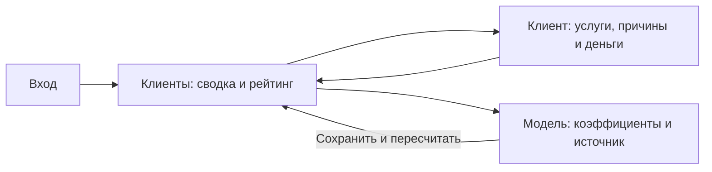

# План интерфейса

Статус: предметный UX-план, **экраны продукта пока не реализованы**. R-002–009, R-013, R-018, R-030, R-043. До планирования прочитаны `docs/design/README.md`, `DESIGN_SYSTEM.md`, `VISUAL_IDENTITY.md`, `COMPONENTS.md`, `IMPLEMENTATION_GUIDE.md`, `DESIGN_QA_CHECKLIST.md`. Ниже конкретизируются действия маркетолога в утверждённой Digital Ruins / Lost Signal.

## Четыре экрана MVP

1. **Вход** `/login`: логин, пароль, показать/скрыть, «Войти», одно понятное сообщение об ошибке. Поле логина не обязательно email: в ТЗ вход по логину/паролю. Визуальную форму `design/login.html` переиспользовать с этим изменением и реальной отправкой. Регистрацию и профиль не превращать в требования MVP.
2. **Клиенты** `/customers`: краткая сводка, объяснение денежного показателя, фильтр/поиск, обязательная таблица, последняя дата расчёта и состояние связи.
3. **Клиент** `/customers/{id}`: почему требуется внимание, какие услуги влияют на риск, сколько стоит ближайшее продление, как распределены доступные средства, конкретные вклады признаков и предупреждения о качестве данных.
4. **Модель** `/settings`: сохранённые веса, пороги и горизонт; объяснение каждого признака; сохранить/отменить; ниже импорт полного JSON-снимка как отдельная операция.

Плоская верхняя Terminal Bar: `localhost3000`, «Клиенты», «Модель», текущий логин, «Выйти». Ссылка на Swagger может быть в разделе модели/справке. На узком экране доступное раскрытие, без обрезки действий. Sidebar/Floating Dock из `design/dashboard` — локальные исключения прототипа, не выбранная общая навигация.

Художественная `/` сохраняет утверждённую сцену и ведёт к входу; README может сразу направлять жюри на `/login`. Ни анимация, ни сцена не должны задерживать основной путь. Не менять ассеты/wordmark и не делать новый фирменный стиль ради предметной задачи.

## Рейтинг

Верхняя часть отвечает на три вопроса из ТЗ:

- «Кому нужно внимание»: число клиентов высокого риска и переход к отфильтрованной таблице.
- «Почему»: в строке короткая главная причина, в карточке полный расчёт.
- «Сколько под риском»: стоимость ближайших продлений, валюта EUR и объяснение сценарной природы.

Минимальные показатели: клиенты высокого риска, стоимость продлений под риском, число без оценки. Распределение остальных уровней — обычная текстовая строка/список, без бессмысленной сетки карточек. Общая сводка относится ко всему снимку; фильтр влияет только на рейтинг, это видно по подписи результата.

Обязательные столбцы: ID, email, «Баланс, €», «Пополнено за всё время, €», «Риск». Допустимы «Причина» и «Под риском, €», если сохраняется читаемость. Точное значение score и уровень написаны текстом; монохромный значок/линия — дополнение. Нельзя полагаться на красный/зелёный или заменить цифры шкалой без объяснения.

Кнопка в заголовке сортируемого столбца переключает asc/desc и выставляет `aria-sort`. По умолчанию — score desc, неизвестные внизу. Все четыре обязательные сортировки доступны с клавиатуры, выбранное направление видно. На телефоне — отдельный select «Сортировать по» и кнопка направления; скрытый столбец не лишает сортировки. Поиск: ID/email, фильтр: все/высокий/средний/низкий/без оценки.

На 320–360 px: табличный регион может прокручиваться внутри доступного подписанного контейнера; вся страница не получает горизонтальную прокрутку. Альтернатива — карточные строки со всеми пятью полями и сохранением явных контролов сортировки. Не уменьшать шрифт ниже 16 px. Выбор одного варианта зафиксировать до верстки, проверить фактически.

Ссылка email/ID открывает обычный маршрут карточки; работают back/forward и прямой URL. Активный фильтр/сортировка сохраняется в безопасных query-параметрах, без персональных данных и секретов.

## Карточка клиента

Сначала email/ID и score с уровнем или «Недостаточно данных: нет возобновляемых услуг». Затем 1–3 конкретные причины: дата окончания, отключённое автопродление, цена корзины, нехватка средств, ожидание оплаты. Формулировки поступают из модели и подтверждаются видимыми полями.

Блок денег показывает отдельно основной баланс, доступные бонусы, реферальные средства и сумму пополнений. Подпись объясняет, что реферальные средства не расходуются автоматически и заблокированные бонусы не покрывают платёж. Итоговый денежный риск — сумма service-level оценок, не сумма всех счетов клиента.

Список услуг показывает название, цену периода, paymentTerm, срок, статус, autoProlong, score/причины; `blocked/deleted` остаются видны с причиной исключения из прогноза. В «Как рассчитано» — значения/веса/вклады, clamp, горизонт и дата расчёта. История транзакций — компактная раскрываемая таблица контекста, без выдуманных ошибок банков/оттока.

Просроченный сверх пяти дней prolong_wait: «Статус источника не согласован со сроком ожидания» и конкретная дата. Не обещать автоматическое удаление или оплату, которых анализатор не выполняет. Никакой кнопки «Удержать клиента» без реализованного действия.

## Редактор модели и источник

Для каждого признака label, описание и числовой ввод веса; диапазон и сохранённое значение понятны без tooltip. Изменения локальны до «Сохранить и пересчитать». Во время запроса текст действия меняется без скачка размеров. После успеха видны реальные новые результаты/версия; toast не заменяет пересчитанные значения.

Поля H и порогов объясняют бизнес-смысл. Нельзя отправить неверные числа/порядок порогов или все нулевые веса. Ошибка связана с полем `aria-describedby`; введённое не стирается. При 409 предложить загрузить свежие настройки и повторить правку; polling не должен молча затирать несохранённый draft формы.

Импорт расположен отдельно от коэффициентов: выбрать JSON → показать имя/размер → «Заменить аналитический снимок» → явно подтвердить полную замену → список ошибок либо новое количество записей/дата. Исходный файл в `материалы` не меняется. Не добавлять отдельный CRUD биллинга: live демонстрируется через обязательный PUT.

## Состояния, которые реализуются вместе с экраном

| Состояние | Что видит человек |
|---|---|
| Первый запрос | «Загружаем клиентов», `aria-busy`, без фиктивных KPI |
| Пустой источник | «Данные ещё не загружены», переход к импорту только у вошедшего пользователя |
| Пустой фильтр | «Нет клиентов по выбранным условиям», действие сбросить фильтр |
| Unknown | Явный текст причины; прочерк у score/денег, не низкий риск |
| Потеря связи | Последний согласованный результат остаётся с датой и текстом «Не удалось обновить»; retry/backoff |
| 401 / logout в другой вкладке | Очистка клиентских данных и переход к входу |
| 404 клиента | Объяснение и возврат в рейтинг; не старая карточка исчезнувшего ID |
| Ошибка импорта | Точные поля/ссылки, прежний снимок остаётся действующим |
| Изменение в другой вкладке | Результаты обновились, пользовательский фокус/скролл/выделенная сортировка сохранены |

Polling не переотрисовывает всю страницу каждые две секунды, не сбрасывает фокус и не спамит live-region. Объявлять содержательные изменения кратко; сами таблицы обновлять по ID.

## Применение дизайна

Подключать `design/tokens.css`, `fonts.css`, `foundation.css` через явный static mount/сборку. Не копировать значения в product theme. PP Neue Machina Inktrap 400/500, wordmark 600; размеры 32/24/16 px, интерактивные области и интервалы из токенов. Права на публичную поставку proprietary-шрифта проверяются отдельно; не заменять его самовольно.

Рабочие страницы — почти чёрная монохромная плоская структура, центрированный контейнер, длинный текст и числа выровнены по назначению внутри него. Стекло — только оправданный плавающий элемент, выбранный Aceternity Liquid Glass Controls из токенов. В таблицах и полях оптическое искажение мешает чтению и не требуется. Повторно создавать эффекты/Three.js или переносить demo dashboard статистику не нужно.

## P1: честный график

Три разные сущности с отдельными названиями:

1. Текущее количество услуг по уровням риска — факт текущего расчёта, не временная история оттока.
2. Предстоящие даты продления услуг высокого риска — сценарий возможных непродлений по порогу, с подписью о выборе модели; не обученная вероятность. Если показывается сумма score/100, назвать её условной риск-взвешенной величиной, не ожидаемым числом реальных отказов.
3. Исторические удаления — только датированные события. Для исходного snapshot: «История удалений не предоставлена», без придуманного ряда или нулевой линии, выдаваемой за наблюдение.

Новые наблюдения переходов в deleted можно хранить с `observed_at` и прямо называть наблюдёнными переходами, а не точной датой удаления. Исчезновение ID из snapshot само по себе не означает удаление. Тестовые расширенные события обозначать демонстрационными. При отсутствии настоящей истории не обещать полный бонус графика.

Монохромные сплошные/пунктирные линии, штриховки, подписи единиц и таблица значений fallback различают факт и сценарий. Chart.js подключается только если ускоряет эту задачу; в остальных экранах не нужен.

## Приёмка UI

Проверить полный путь в browser tool на 360/768/1440 px, дополнительно 320 px и 200% zoom; клавиатуру, видимый фокус, labels, контраст, длинный email, число без оценки, сетевой сбой и reduced motion. Сверять числа с backend Evaluation. Подробный список — [test-plan.md](test-plan.md) и [DESIGN_QA_CHECKLIST](design/DESIGN_QA_CHECKLIST.md). Подготовленный план/нативный прототип не является проверенным интерфейсом продукта.
